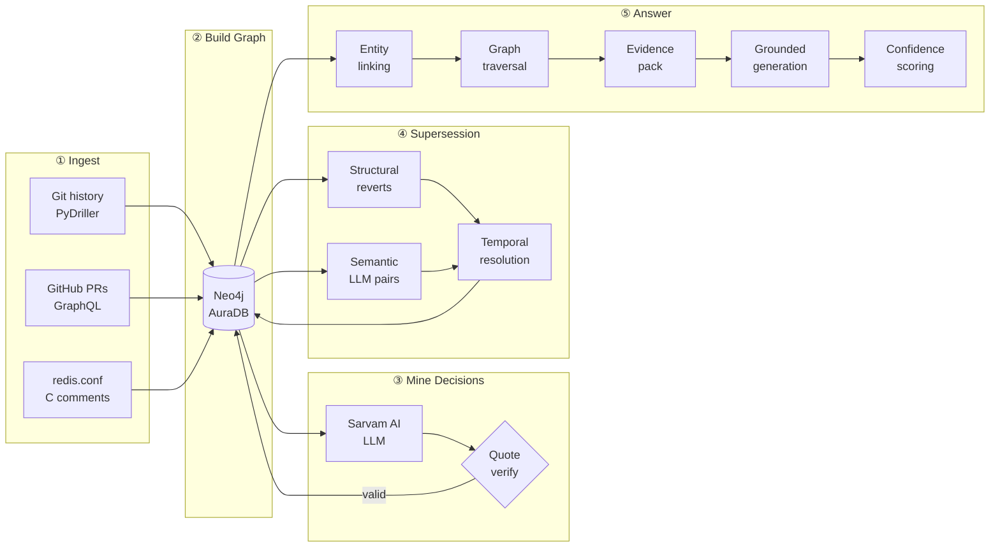
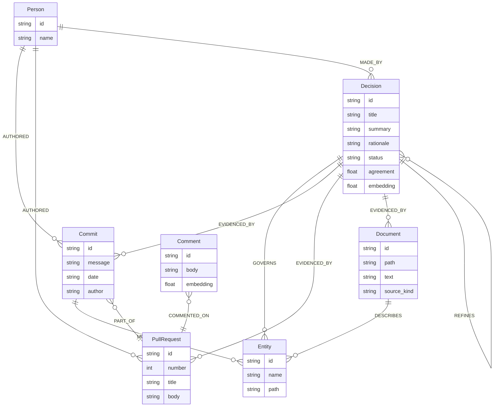
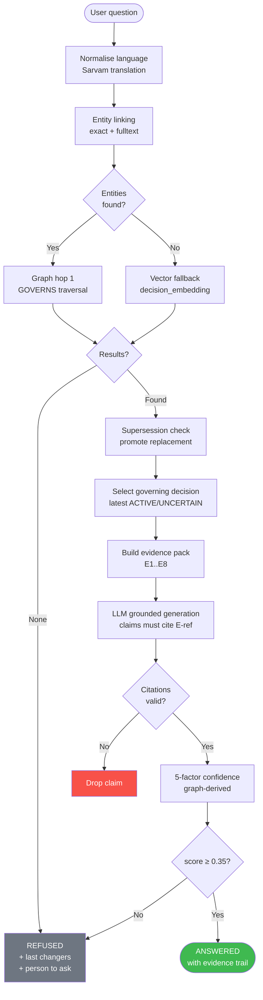
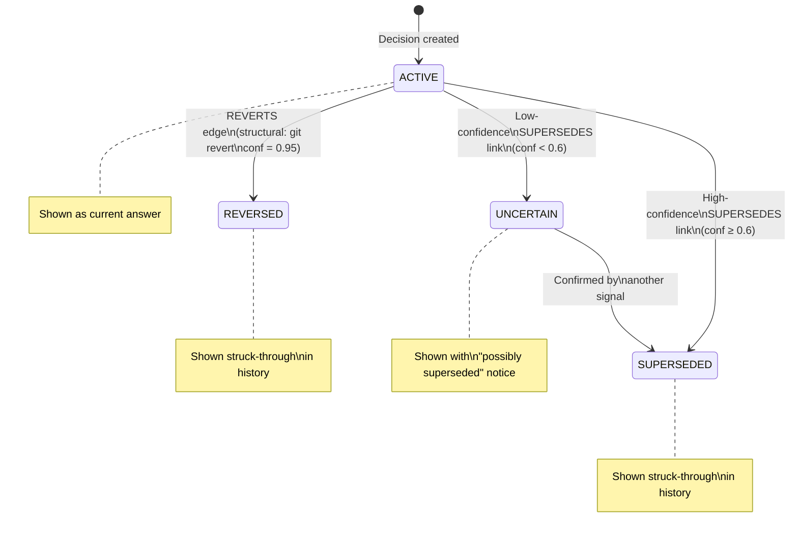
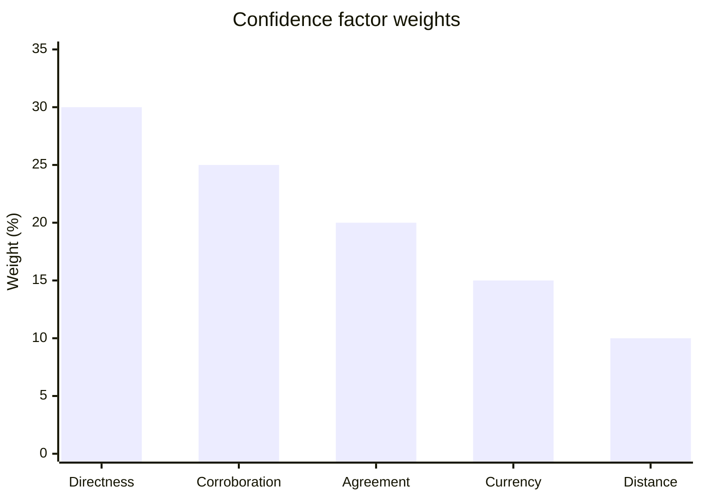
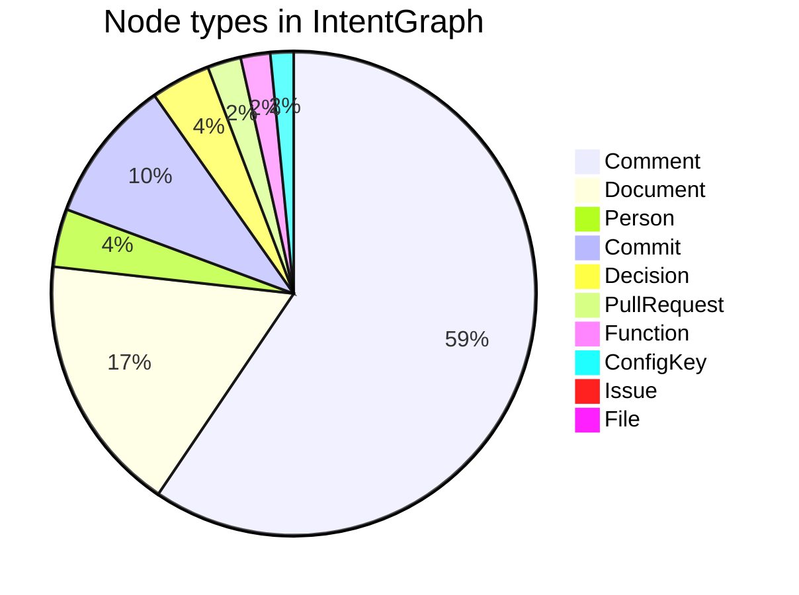
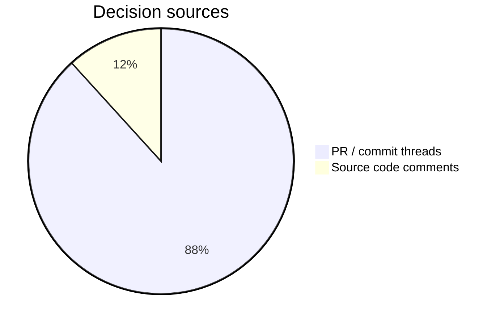
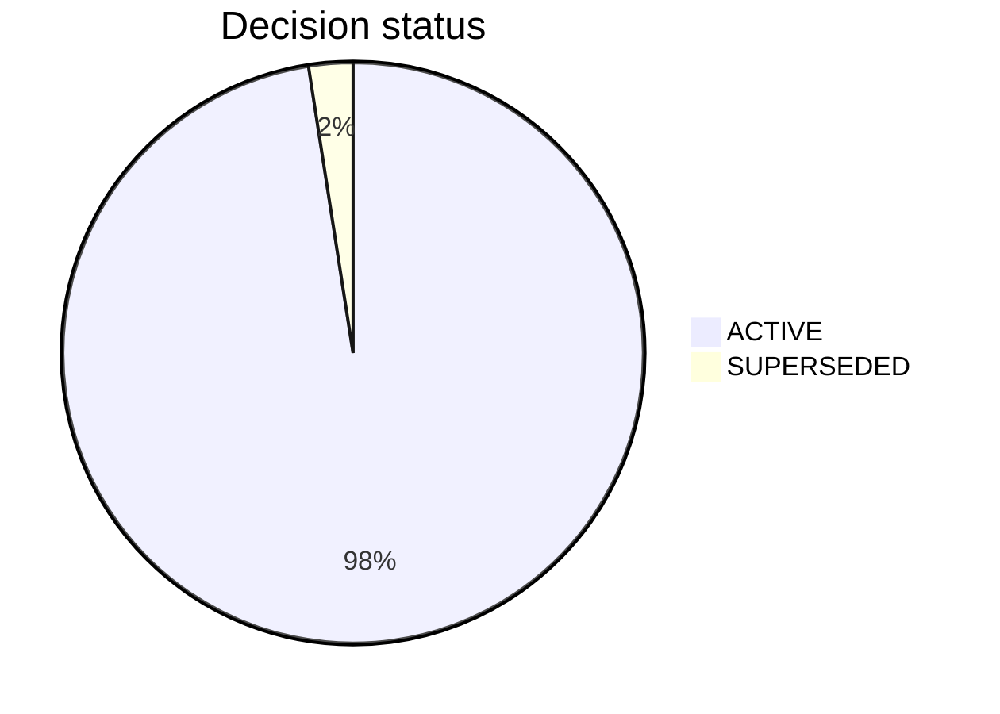
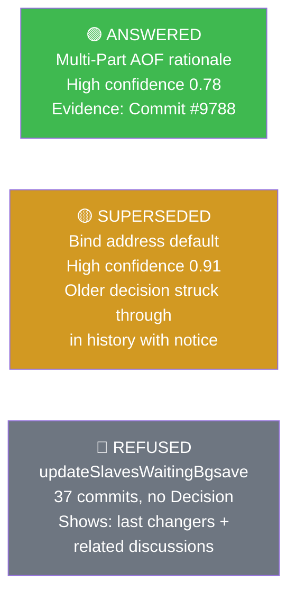

# IntentLens

> **Connect code to the decisions that shaped it.**

IntentLens answers *"why is the code like this?"* for a software repository. It ingests git history, GitHub pull requests, and source-code comments, builds a Neo4j knowledge graph that links every code entity to the engineering decision behind it, and answers natural-language questions with a cited evidence trail — refusing to guess when the graph has no answer.

Built for **hackFront India · PS 01 · Neo4j track** (Best Use of Neo4j).

---

## Table of Contents

1. [The Problem](#the-problem)
2. [How It Works — Five-Stage Pipeline](#how-it-works--five-stage-pipeline)
3. [Knowledge Graph Schema](#knowledge-graph-schema)
4. [Question-Answering Pipeline](#question-answering-pipeline)
5. [Supersession Detection](#supersession-detection)
6. [Confidence Scoring](#confidence-scoring)
7. [What's in the Graph (Redis demo)](#whats-in-the-graph-redis-demo)
8. [Tech Stack](#tech-stack)
9. [Quick Start](#quick-start)
10. [Project Structure](#project-structure)
11. [API Reference](#api-reference)
12. [Evaluation](#evaluation)
13. [Design Principles](#design-principles)

---

## The Problem

When a senior engineer leaves, the *reasoning* behind the code leaves with them.

```
Developer asks:  "Why is repl-diskless-sync set to yes by default?"
Search gives:    150 commits mentioning the setting
Wiki says:       Last updated 2019, probably wrong
LLM hallucinates: "It reduces memory pressure" (invented, uncited)
```

IntentLens gives:

```
ANSWERED  ·  High confidence  ·  Evidence: Commit ae899589 (2022-01-17)

"repl-diskless-sync was set to yes by default to align with faster
replication in modern deployments where network bandwidth is plentiful.
[E1]  The diskless approach avoids writing a temporary RDB file to disk,
reducing I/O latency during replica sync. [E1]"

Decision:  Set repl-diskless-sync to yes by default (#10092)
Decided:   2022-01-17  ·  by: oranagra
Evidence:  E1 = Commit ae899589
```

---

## How It Works — Five-Stage Pipeline

```
┌─────────────────────────────────────────────────────────────────────────┐
│                      IntentLens Data Pipeline                           │
└─────────────────────────────────────────────────────────────────────────┘

  ┌──────────┐    ┌──────────────┐    ┌────────────────┐
  │  Stage 1 │    │   Stage 2    │    │    Stage 3     │
  │  INGEST  │───▶│ BUILD GRAPH  │───▶│ MINE DECISIONS │
  └──────────┘    └──────────────┘    └────────────────┘
       │                 │                     │
  git log          Neo4j AuraDB          LLM (Sarvam)
  GitHub GraphQL   Entities, Evidence    Two-pass mining
  redis.conf       570 decisions         Quote verification
  C comments       27,249 edges          Agreement scoring
       │                 │                     │
       ▼                 ▼                     ▼
  JSONL cache      Knowledge Graph      Verified decisions
  (resumable)      (idempotent)         (with spans)
                          │
                          ▼
                  ┌────────────────┐    ┌────────────────┐
                  │    Stage 4     │    │    Stage 5     │
                  │  SUPERSESSION  │───▶│    ANSWER      │
                  └────────────────┘    └────────────────┘
                          │                     │
                  3-signal engine        GraphRAG pipeline
                  18 SUPERSEDES          Entity linking
                  40 REFINES             Evidence pack
                  14 non-active          5-factor confidence
```

### Stage 1 — Ingest

| Source | Tool | Output |
|--------|------|--------|
| Git history | PyDriller | `commits.jsonl` (1,372 commits) |
| GitHub PRs & issues | GraphQL API | `threads.jsonl` (314 PRs) |
| redis.conf comments | `ingest_docs.py` | `documents.jsonl` (63 blocks) |
| C source comments | `ingest_docs.py` | `documents.jsonl` (179 blocks, rationale-filtered) |

All stages write JSONL to `data/cache/` and are **resumable** — re-running adds only new records.

### Stage 2 — Build Graph

Idempotent MERGE batches push all entities into Neo4j:

- Commit → File/Function/ConfigKey relationships (MODIFIES)
- PullRequest → Comment → Person relationships
- Document → ConfigKey/Function/File (DESCRIBES)
- REFERENCES edges from `#NNN` in commit messages

### Stage 3 — Mine Decisions

For each PR thread, commit message, and Document block:

```
                    ┌─────────────────────────────────┐
                    │         Decision Mining          │
                    └─────────────────────────────────┘

Thread text          Pass A (normal prompt)     Pass B (conservative)
─────────────        ──────────────────────     ────────────────────
[pr:9788]      ───▶  Extract decisions    ───┐
(2022-01-04)                                 ├──▶  Agreement score
Multi-Part AOF       Extract decisions    ───┘     (cosine similarity
...                                                 of summaries)
                              │
                              ▼
                     Quote verification
                     (verbatim match in source)
                              │
                              ▼
                    Verified decisions stored
                    in Neo4j with embeddings
```

Every decision **must** include a verbatim quote from the source. Claims without valid citations are dropped before storage.

### Stage 4 — Supersession Detection

Three signals detect when one decision overrides another:

```
┌──────────────────────────────────────────────────────────┐
│              Supersession Detection Engine               │
└──────────────────────────────────────────────────────────┘

① STRUCTURAL          ② SEMANTIC              ③ TEMPORAL
  (git revert)          (LLM pair classify)     (status resolution)

  "This reverts        consecutive pairs       compute_statuses()
   commit SHA"    ───▶  per entity        ───▶  ACTIVE
                        + high-cosine           SUPERSEDED
  → REVERTS edge        cross-entity            REVERSED
    conf = 0.95         pairs                   UNCERTAIN
                        classify:
                        reinforces /
                        refines /
                        contradicts /
                        unrelated
                        → SUPERSEDES or
                          REFINES edge
```

Result: **18 SUPERSEDES + 40 REFINES** edges across 570 decisions.

### Stage 5 — Answer

See [Question-Answering Pipeline](#question-answering-pipeline).

---

## Knowledge Graph Schema

```
┌─────────────────────────────────────────────────────────────────────┐
│                    IntentGraph — Node Types                         │
└─────────────────────────────────────────────────────────────────────┘

                    ┌──────────────┐
                    │    Person    │
                    │  email/login │
                    └──────┬───────┘
                           │ AUTHORED
              ┌────────────▼─────────────┐
              │                          │
    ┌─────────▼──────┐         ┌─────────▼──────┐
    │    Commit      │         │  PullRequest   │
    │  sha·date·msg  │         │  number·title  │
    └─────────┬──────┘         └─────────┬──────┘
              │ MODIFIES                 │ has
              │                          │
    ┌─────────▼──────┐         ┌─────────▼──────┐
    │    Entity      │         │    Comment     │
    │  (3 subtypes)  │         │  author·body   │
    │                │         └────────────────┘
    │  ┌──────────┐  │
    │  │   File   │  │
    │  └──────────┘  │
    │  ┌──────────┐  │◄──GOVERNS──┐
    │  │ Function │  │             │
    │  └──────────┘  │   ┌─────────┴──────┐
    │  ┌──────────┐  │   │   Decision     │
    │  │ConfigKey │  │   │  title·summary │
    │  └──────────┘  │   │  rationale     │
    └────────────────┘   │  status·agree  │
                         │  embedding     │
    ┌────────────────┐   └───────┬────────┘
    │   Document     │           │ EVIDENCED_BY
    │  path·text·url │◄──────────┘
    │  source_kind   │
    └────────────────┘

  Decision status values:
  ● ACTIVE      — current answer
  ○ SUPERSEDED  — replaced by a newer decision
  ○ REVERSED    — explicitly reverted
  ~ UNCERTAIN   — possible replacement, low confidence
```

### Relationship Types

```
┌────────────────────────────────────────────────────────────────┐
│                    Edge Dictionary                             │
├────────────────────────┬───────────────────────────────────────┤
│ GOVERNS                │ Decision ──► Entity                   │
│                        │ "this decision applies to this entity" │
├────────────────────────┼───────────────────────────────────────┤
│ EVIDENCED_BY           │ Decision ──► Commit/PR/Comment/Doc    │
│                        │ "this source supports the decision"   │
├────────────────────────┼───────────────────────────────────────┤
│ MODIFIES               │ Commit ──► File/Function/ConfigKey    │
│                        │ "this commit changed this entity"     │
├────────────────────────┼───────────────────────────────────────┤
│ SUPERSEDES             │ Decision ──► Decision                 │
│                        │ "newer overrides older"               │
├────────────────────────┼───────────────────────────────────────┤
│ REFINES                │ Decision ──► Decision                 │
│                        │ "newer extends without overriding"    │
├────────────────────────┼───────────────────────────────────────┤
│ REVERTS                │ Decision ──► Decision                 │
│                        │ "structural git revert"               │
├────────────────────────┼───────────────────────────────────────┤
│ DESCRIBES              │ Document ──► Entity                   │
│                        │ "comment block explains this entity"  │
├────────────────────────┼───────────────────────────────────────┤
│ AUTHORED               │ Person ──► Commit/PR/Decision         │
├────────────────────────┼───────────────────────────────────────┤
│ MADE_BY                │ Decision ──► Person                   │
├────────────────────────┼───────────────────────────────────────┤
│ PART_OF                │ Commit ──► PullRequest                │
├────────────────────────┼───────────────────────────────────────┤
│ REFERENCES             │ Commit/PR ──► Issue/PR                │
└────────────────────────┴───────────────────────────────────────┘
```

---

## Question-Answering Pipeline

```
┌─────────────────────────────────────────────────────────────────┐
│                   POST /ask  Pipeline                           │
└─────────────────────────────────────────────────────────────────┘

User question
     │
     ▼
┌────────────────────────────────────┐
│  1. Language normalisation          │  Hindi/Hinglish → English
│     (Sarvam AI translation)         │  code identifiers preserved
└────────────────┬───────────────────┘
                 │
                 ▼
┌────────────────────────────────────┐
│  2. Entity linking                  │  exact: "repl-backlog-size"
│     exact match → fulltext search   │  fuzzy: entity_names index
└────────────────┬───────────────────┘
                 │
         ┌───────┴────────┐
         │ entities found? │
         └───────┬────────┘
              yes│             no
                 ▼             ▼
┌───────────────────┐  ┌──────────────────────┐
│ 3a. Graph hop 1   │  │ 3b. Vector fallback   │
│ GOVERNS traversal │  │ decision_embedding    │
│ (parameterised    │  │ cosine similarity     │
│  Cypher only)     │  │ (hop 2)               │
└─────────┬─────────┘  └──────────┬────────────┘
          └──────────┬────────────┘
                     │
                     ▼
┌────────────────────────────────────┐
│  4. Supersession check              │  SUPERSEDED/REVERSED →
│     promote replacement             │  fetch & show replacement
└────────────────┬───────────────────┘
                 │
                 ▼
┌────────────────────────────────────┐
│  5. Select governing decision       │  latest ACTIVE/UNCERTAIN
│     build evidence pack  E1..E8     │  sort by date
└────────────────┬───────────────────┘
                 │
                 ▼
┌────────────────────────────────────┐
│  6. Grounded generation             │  LLM returns JSON claims
│     citation verification           │  each claim must cite E-ref
│     invalid citations dropped       │  from the pack
└────────────────┬───────────────────┘
                 │
                 ▼
┌────────────────────────────────────┐
│  7. Confidence scoring              │  5 graph-derived factors
│     (never LLM self-rating)         │  see below
└────────────────┬───────────────────┘
                 │
         ┌───────┴────────┐
         │ score ≥ 0.35?  │
         └───────┬────────┘
              yes│             no
                 ▼             ▼
           ANSWERED          REFUSED
           with evidence      + last changers
                              + closest discussions
                              + person to ask
```

---

## Supersession Detection

```
┌──────────────────────────────────────────────────────────────┐
│  Example: repl-diskless-sync default change                  │
└──────────────────────────────────────────────────────────────┘

  2014-10-24                    2022-01-17
  ┌──────────────────────┐      ┌────────────────────────────┐
  │ "Diskless replication │      │ "Set repl-diskless-sync    │
  │  documented in        │      │  to yes by default"        │
  │  redis.conf (no=off)" │      │  (#10092)                  │
  │                       │      │                            │
  │  status: SUPERSEDED   │◄─────│  status: ACTIVE            │
  └──────────────────────┘      └────────────────────────────┘
           SUPERSEDES edge,  confidence=1.00
           reason: "NEWER changes the default from no to yes,
                    directly contradicting OLDER"

  Query result:
  ┌──────────────────────────────────────────────────────────┐
  │ ⚠ SUPERSEDED NOTICE                                      │
  │ The earlier decision "Diskless documented as no" (2014)  │
  │ was superseded on 2022-01-17.                            │
  │ Showing the CURRENT decision.                            │
  └──────────────────────────────────────────────────────────┘
  CURRENT: "Set repl-diskless-sync to yes by default"
  HISTORY: ~~"Diskless replication documented as no"~~
```

---

## Confidence Scoring

```
┌──────────────────────────────────────────────────────────────┐
│           Confidence = Σ weight_i × factor_i                 │
└──────────────────────────────────────────────────────────────┘

  Factor          Weight   Value formula
  ─────────────── ──────   ──────────────────────────────────────
  Directness       30%     1.0 if explicit rationale in source
                           0.5 if rationale is inferred

  Corroboration    25%     0.4 = 1 source type
                           0.7 = 2 source types
                           1.0 = 3+ source types

  Agreement        20%     cosine(summary_passA, summary_passB)
                           two independent LLM mining passes

  Currency         15%     1 − min(1, drift_commits / 5)
                           how many commits touched entity
                           after decision without a new decision

  Distance         10%     1 − (hops − 1) / MAX_GRAPH_HOPS
                           hop 1 = direct GOVERNS match
                           hop 2 = vector similarity match

  ─────────────────────────────────────────────────────────────
  Thresholds:   High ≥ 0.75  ·  Medium ≥ 0.55  ·  Low ≥ 0.35
                Below 0.35 → REFUSED (never guesses)
```

---

## What's in the Graph (Redis demo)

The demo loads the **replication and persistence subsystem** of `redis/redis`:
`src/replication.c`, `src/rdb.c`, `src/aof.c`, `redis.conf`.

### Node counts

| Label | Count | Description |
|-------|------:|-------------|
| Decision | **570** | Mined engineering decisions |
| Comment | 8,502 | PR and issue comments |
| Document | 2,478 | Config + code comment blocks |
| Commit | 1,372 | Subsystem-touching commits |
| Person | 554 | Authors and contributors |
| PullRequest | 321 | GitHub pull requests |
| Function | 282 | C functions |
| ConfigKey | 222 | `redis.conf` settings |
| Issue | 43 | GitHub issues |
| File | 4 | Source files |
| **Total** | **14,348** | |

### Relationship counts

| Type | Count |
|------|------:|
| AUTHORED | 10,188 |
| COMMENTED_ON | 8,502 |
| MODIFIES | 4,546 |
| REFERENCES | 1,215 |
| EVIDENCED_BY | 860 |
| MADE_BY | 779 |
| GOVERNS | 673 |
| DESCRIBES | 304 |
| REFINES | 40 |
| SUPERSEDES | 18 |
| **Total** | **27,249** |

### Decision sources

```
  pr_or_commit  ████████████████████████████████████████  503  (88%)
  document      ███████                                    67  (12%)
```

### Decision status

```
  ACTIVE      ████████████████████████████████████████  556  (97.5%)
  SUPERSEDED  █                                          14   (2.5%)
```

### Three demo questions (confirmed live)

| State | Question | Confidence |
|-------|----------|-----------|
| ✅ **ANSWERED** | What is the rationale for the Multi-Part AOF mechanism in Redis 7.0? | High (0.78) |
| ⚠ **SUPERSEDED** | Why does Redis fail to start by default when a requested bind address is not available? | High (0.91) |
| ❌ **REFUSED** | What design decision explains why `updateSlavesWaitingBgsave` uses its current implementation strategy? | No answer |

The SUPERSEDED question surfaces the older decision ("`Add '-' prefix to allow EADDRNOTAVAIL to be ignored`") struck through in history, plus a superseded notice with the current decision.

The REFUSED question demonstrates honest refusal: `updateSlavesWaitingBgsave` has 37 commits but no mined decision, so IntentLens returns last changers and related discussions instead of guessing.

---

## Tech Stack

```
┌──────────────────────────────────────────────────────────────┐
│                      Technology Stack                        │
└──────────────────────────────────────────────────────────────┘

  DATA LAYER
  ├── Neo4j AuraDB (Cypher 5)   knowledge graph + vector index
  ├── PyDriller                  git history traversal
  └── GitHub GraphQL API         PR / issue ingestion

  AI LAYER
  ├── Sarvam AI sarvam-105b      LLM for mining + answering
  │                              + Hindi/Hinglish translation
  ├── sentence-transformers      all-MiniLM-L6-v2 (384d embeds)
  └── Two-pass mining            agreement scoring via cosine sim

  BACKEND
  ├── FastAPI + Pydantic v2       REST API (8 endpoints)
  ├── Parameterised Cypher only  no LLM-generated queries
  └── 5-factor confidence        graph-derived, not self-rated

  FRONTEND
  ├── React 18 + Vite             SPA with lazy-loaded routes
  ├── @neo4j-nvl/react            interactive graph explorer
  ├── Fraunces + Outfit fonts     evidence trail design system
  └── WCAG AA contrast            dark/light theme, 375px+
```

---

## Quick Start

### Prerequisites

- Python 3.11+
- Node.js 18+
- Neo4j AuraDB free instance → [console.neo4j.io](https://console.neo4j.io)
- Sarvam AI API key → [sarvam.ai](https://sarvam.ai)
- GitHub personal access token (public_repo read scope)

### 1. Clone and set up

```bash
git clone https://github.com/YOUR_USERNAME/intentlens.git
cd intentlens
python -m venv .venv
.venv/Scripts/activate       # Windows
# source .venv/bin/activate  # macOS/Linux
pip install -r requirements.txt
```

### 2. Configure

```bash
cp .env.example .env
# Fill in your Neo4j, Sarvam, and GitHub credentials
```

### 3. Set up the graph schema

```bash
python -m scripts.apply_schema
```

### 4. Run the full data pipeline

```bash
# Ingest git history + GitHub PRs (resumable)
python -m scripts.ingest

# Build the knowledge graph + mine decisions
python -m scripts.build_graph

# Detect supersession relationships
python -m scripts.run_supersession
```

### 5. Start the app

```bash
# Terminal 1 — backend
python -m uvicorn backend.app.main:app --host 127.0.0.1 --port 8000 --reload

# Terminal 2 — frontend
cd frontend
npm install
npm run dev
```

Open **http://localhost:5173** — or try **http://localhost:5173/ask?demo=1** for the one-click demo.

---

## Project Structure

```
intentlens/
├── backend/
│   └── app/
│       ├── config.py              settings from .env
│       ├── models.py              Pydantic models
│       ├── main.py                FastAPI app (8 endpoints)
│       ├── ingestion/
│       │   ├── git_ingest.py      PyDriller git history
│       │   ├── github_ingest.py   GitHub GraphQL PRs
│       │   └── doc_ingest.py      doc section chunker
│       ├── extraction/
│       │   ├── entities.py        config keys, functions, refs
│       │   └── decision_miner.py  LLM mining + verification
│       ├── graph/
│       │   ├── db.py              Neo4j driver wrapper
│       │   ├── loader.py          idempotent MERGE loaders
│       │   └── schema.cypher      constraints + indexes
│       ├── reasoning/
│       │   ├── supersession.py    3-signal engine
│       │   └── confidence.py      5-factor scorer
│       └── retrieval/
│           ├── cypher.py          parameterised templates
│           └── graphrag.py        full QA pipeline
├── frontend/
│   └── src/
│       ├── pages/
│       │   ├── Landing.jsx        hero + live stats
│       │   ├── Ask.jsx            question workspace
│       │   ├── Explore.jsx        NVL graph explorer
│       │   ├── How.jsx            pipeline + schema docs
│       │   ├── Results.jsx        evaluation table
│       │   └── About.jsx          project info
│       ├── components/
│       │   ├── AnswerCard.jsx     answered/superseded/refused
│       │   ├── GraphView.jsx      NVL wrapper + side panel
│       │   └── ...
│       └── demoQuestions.js       5 verified demo questions
├── scripts/
│   ├── ingest.py                  run all ingestion stages
│   ├── build_graph.py             load + mine decisions
│   ├── run_supersession.py        detect supersession
│   ├── ingest_docs.py             extract rationale comments
│   └── full_build.py              end-to-end orchestration
├── eval/
│   ├── supersession_found.md      58 supersession edges
│   ├── build_summary.md           graph statistics
│   └── source_audit.md            source quality analysis
├── docs/
│   ├── ARCHITECTURE.md            detailed technical design
│   └── EVALUATION.md              evaluation methodology
├── data/
│   ├── cache/                     JSONL cache (gitignored)
│   └── repo/                      cloned redis/redis (gitignored)
├── .env.example                   credential template
├── .gitignore
└── README.md                      this file
```

---

## API Reference

| Method | Endpoint | Description |
|--------|----------|-------------|
| `POST` | `/ask` | Ask a "why" question, get a cited answer |
| `GET` | `/entity/graph?id=` | Decision neighbourhood for an entity |
| `GET` | `/entities/search?q=` | Autocomplete entity search |
| `GET` | `/stats` | Live graph counts for the landing page |
| `GET` | `/eval/results` | Parsed evaluation results |
| `GET` | `/health` | Liveness probe |
| `GET` | `/ready` | Readiness probe (Neo4j + LLM) |

### POST /ask — example

```bash
curl -X POST http://localhost:8000/ask \
  -H "Content-Type: application/json" \
  -d '{"question": "Why does Redis use a shared replication buffer?"}'
```

Response shape:

```json
{
  "status": "answered",
  "answer": "Redis uses a shared replication buffer to reduce...[E1]",
  "decision": {
    "title": "Replication backlog and replicas use one global shared buffer",
    "status": "ACTIVE",
    "decided_on": "2021-10-25",
    "rationale": "Per-replica output buffers caused high memory usage..."
  },
  "superseded_notice": null,
  "evidence": [
    { "ref": "E1", "kind": "Commit", "url": "...", "quote": "..." }
  ],
  "confidence": { "score": 0.82, "label": "High" },
  "person_to_ask": { "name": "Oran Agra", "reason": "Most commits" }
}
```

---

## Evaluation

IntentLens is compared against a **vector-RAG baseline** (top-5 comments by embedding similarity, no graph traversal, no supersession check, never refuses).

| Capability | Vector-RAG | IntentLens |
|-----------|-----------|-----------|
| Answers with citations | ❌ | ✅ |
| Detects superseded decisions | ❌ | ✅ |
| Refuses unanswerable questions | ❌ (always guesses) | ✅ |
| Calibrated confidence score | ❌ | ✅ |
| Links to author / person to ask | ❌ | ✅ |
| Hindi/Hinglish questions | ❌ | ✅ |

Run the evaluation harness:

```bash
python -m scripts.run_eval
```

---

## Design Principles

1. **Every answer carries evidence.** No sentence is shown without citing at least one evidence ID from the graph. Claims without valid citations are dropped before the answer reaches you.

2. **Supersession is honoured.** A decision with status `SUPERSEDED` or `REVERSED` is never presented as the current answer. It appears only in history, with a link to its replacement.

3. **Refusal is a feature.** If no decision governs the entity within `MAX_GRAPH_HOPS`, or confidence is below `REFUSAL_THRESHOLD` (0.35), the system refuses and tells you who to ask instead.

4. **Confidence is computed from graph facts.** The LLM never self-rates its own answer. Five graph-derived factors (directness, corroboration, agreement, currency, distance) produce a score independent of the model's self-confidence.

5. **The LLM never writes Cypher.** All graph queries are parameterised templates in `retrieval/cypher.py`. No free-form query generation, ever.

---

## Hackathon Context

- **Event:** hackFront India
- **Theme:** AI and Developer Tools
- **Problem statement:** PS 01 — "Why The Code Is Like This"
- **Track:** Neo4j (Best Use of Neo4j)
- **Demo repo:** redis/redis, subsystem: replication + persistence

---

*Built with Neo4j AuraDB · Sarvam AI · FastAPI · React 18*

---

## Diagrams (GitHub renders these automatically)

### Pipeline Flow



---

### Knowledge Graph Schema



---

### Question-Answering Flow



---

### Supersession State Machine



---

### Confidence Formula



---

### Graph Statistics (Redis demo)







---

### Three Demo Question States


